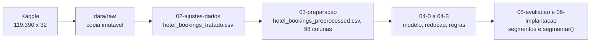

# Fonte de dados

Esta página descreve **de onde vêm os dados** do projeto: a origem, como ela está
organizada, qual é o grão de cada registro e como a carga é reproduzida.

## Origem

A base é a *Hotel Booking Demand*, publicada por Nuno Antonio, Ana de Almeida e Luis
Nunes (2019) no periódico *Data in Brief*, e distribuída no Kaggle pela usuária
jessemostipak. Reúne reservas de dois hotéis portugueses, um resort e um hotel urbano,
feitas entre julho de 2015 e agosto de 2017.

O download é direto, sem cadastro, a partir do Kaggle:

```
https://www.kaggle.com/datasets/jessemostipak/hotel-booking-demand
```

!!! quote "Citação obrigatória"
    Antonio, N., de Almeida, A., & Nunes, L. (2019). *Hotel booking demand datasets.*
    **Data in Brief**, 22, 41-49.

!!! warning "Licença e uso"
    A base é distribuída sob licença **CC BY 4.0**: uso livre, inclusive comercial,
    desde que a autoria seja citada. Não há dado pessoal identificável: não existe
    nome, documento ou contato do hóspede em nenhuma coluna; `agent` e `company` são
    identificadores internos da operação, não da pessoa hospedada.

### Extração vigente

Extração única, correspondente ao arquivo publicado com o artigo. A base é lida em
`00-dicionario-dados.ipynb` a partir de `data/raw/hotel_bookings.csv`, com os valores
textuais `NULL` da origem convertidos em ausência (`NaN`) durante a leitura.

### As 32 colunas originais, por dimensão de negócio

| Dimensão | Exemplos de colunas na origem |
|:---|:---|
| Identificação do hotel | `hotel` |
| Desfecho (rótulo reservado) | `is_canceled`, `reservation_status`, `reservation_status_date` |
| Antecedência e calendário | `lead_time`, `arrival_date_year`, `arrival_date_month`, `arrival_date_week_number`, `arrival_date_day_of_month` |
| Estadia | `stays_in_weekend_nights`, `stays_in_week_nights` |
| Hóspedes | `adults`, `children`, `babies` |
| Canal e origem | `meal`, `country`, `market_segment`, `distribution_channel`, `agent`, `company` |
| Histórico do hóspede | `is_repeated_guest`, `previous_cancellations`, `previous_bookings_not_canceled` |
| Quarto e tarifa | `reserved_room_type`, `assigned_room_type`, `booking_changes`, `deposit_type`, `adr` |
| Operação da reserva | `days_in_waiting_list`, `customer_type`, `required_car_parking_spaces`, `total_of_special_requests` |

O dicionário completo, coluna a coluna, com o tipo semântico atribuído a cada uma, é
gerado em `00-dicionario-dados.ipynb` e salvo em `data/processed/dicionario.csv`.

## Organização da origem

Arquivo único, tabulado (CSV), sem particionamento.

```
data/raw/
└── hotel_bookings.csv   # cópia imutável da origem
```

| Característica | Valor |
|:---|---:|
| Arquivos | 1 |
| Registros | 119.390 |
| Colunas | 32 |
| Período | julho de 2015 a agosto de 2017 |

## Grão e conteúdo

Cada linha é **uma reserva** feita em um dos dois hotéis. Não há uma coluna
identificadora única de reserva: `is_canceled`, `agent`, `company` e as demais
colunas descrevem a reserva, mas nenhuma delas (nem a combinação de todas) garante
que duas linhas iguais sejam reservas diferentes. Por isso a base tem 26,8% de
linhas exatamente duplicadas, registradas e mantidas, não descartadas, como descrito
em [Entendimento dos dados](entendimento-dados.md).

As métricas aditivas são poucas, porque a base é predominantemente categórica:

| Métrica | Descrição |
|:---|:---|
| `adr` | Tarifa média diária da reserva (*Average Daily Rate*) |
| `lead_time` | Dias de antecedência entre a reserva e a chegada prevista |
| `stays_in_weekend_nights` + `stays_in_week_nights` | Total de noites da estadia (derivado em `total_nights`) |
| `adults` + `children` + `babies` | Total de hóspedes da reserva (derivado em `total_guests`) |

## Fluxo de dados no projeto



A carga é implementada nos próprios notebooks, não em um módulo de ingestão
separado: cada notebook lê `data/raw/hotel_bookings.csv` (ou a saída do notebook
anterior) e grava o arquivo seguinte em `data/processed/`. É idempotente, porque
cada etapa sempre parte da base bruta ou da saída documentada da etapa anterior,
nunca de um arquivo editado à mão.

## Fontes complementares

Nenhuma. Todo o projeto se apoia na base única do Kaggle.

## Reprodução

```bash
uv run jupyter nbconvert --to notebook --execute --inplace notebooks/00-dicionario-dados.ipynb
uv run jupyter nbconvert --to notebook --execute --inplace notebooks/01-analise-exploratoria.ipynb
```

!!! tip "Se a origem sair do ar"
    O arquivo bruto não é versionado no repositório (`data/raw/` está no
    `.gitignore`); quem clonar o repositório precisa baixar `hotel_bookings.csv` do
    Kaggle e colocá-lo em `data/raw/` antes de rodar os notebooks.
