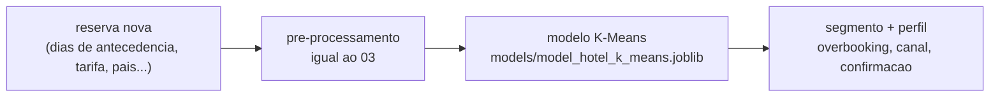

# Implementação

Um resultado só é útil quando quem decide consegue acessá-lo. Esta página descreve **como a
entrega chega ao usuário**, como ela é mantida em funcionamento e como o projeto é encerrado.

!!! tip "Como preencher esta página"
    A complexidade desta fase varia muito: pode ser um relatório recorrente, um painel, um
    arquivo publicado em rede ou um serviço em produção. Descreva o que se aplica ao seu
    caso e remova o resto.

    Regras práticas:

    - defina o **consumidor** da entrega antes do meio: quem abre, com que frequência e para
      decidir o quê;
    - descreva como a entrega é **atualizada**: entrega que só existe porque alguém rodou o
      notebook uma vez não está implantada;
    - modelo em produção **degrada**: sem plano de monitoramento, a fase de implantação está
      incompleta;
    - registre o que acontece **quando falha**: quem é avisado e qual é o comportamento
      esperado enquanto não há dado novo;
    - encerre com o relatório final e a retrospectiva, senão o aprendizado fica só no
      repositório.

## Plano de implantação

A entrega é a função `segmentar()`, definida em `notebooks/06-implantacao.ipynb`:
recebe uma ou mais reservas novas, em unidades de negócio (dias de antecedência,
tarifa, país...), e devolve o segmento de cada uma, mais o perfil desse segmento na
carteira (taxa de cancelamento, antecedência mediana, tarifa mediana). Foi escolhida
em vez de um serviço web porque, nesta fase do projeto, o consumidor é a própria
equipe técnica e de reservas rodando o notebook, não um sistema externo; expor como
API fica para uma iteração futura se a operação adotar o modelo no dia a dia.

| Entrega | Consumidor | Meio | Frequência |
|:---|:---|:---|:---|
| Segmento da reserva + perfil do segmento | equipe de reservas e revenue management | notebook `06-implantacao.ipynb` (função `segmentar()`) | sob demanda, reserva a reserva ou em lote via CSV |

A atualização é manual: alguém roda o notebook com a lista de reservas novas, ou
chama `segmentar(pd.read_csv('arquivo.csv', sep=';').to_dict('records'))` para um
lote. O artefato (modelo `.joblib` e `selecionado.json`) fica em `models/`, local,
não publicado; se a operação quiser usar isso fora do notebook, o próximo passo é
empacotar `segmentar()` numa aplicação simples, no mesmo espírito do
`app/app_imobiliario.py` do projeto de referência.

## Monitoramento e manutenção

Indicadores definidos em `05-avaliacao.ipynb`, seção de impacto operacional.

| O que monitorar | Como | Periodicidade | Ação se desviar |
|:---|:---|:---|:---|
| Concordância do modelo carregado com `segmentos.csv` | `06-implantacao.ipynb`, célula de verificação (hoje 100%) | a cada carregamento do modelo | reexecutar o `04-0` e regravar os artefatos |
| Acurácia de reserva nova classificada (hoje 99,7%) | validação cruzada no `05-avaliacao.ipynb` | semestral, ou a cada 10% de reservas novas acumuladas | re-treinar o classificador e revisar os segmentos |
| Tamanho do maior segmento (hoje 27,1% da carteira) | tabela `perfil` do `05`/`06` | a cada re-treino | se ultrapassar 90%, revisar k ou a regra de aprovação do `04-0` |
| Taxa de cancelamento por segmento (hoje de 15,1% a 99,7%) | tabela `perfil`, coluna `taxa_cancelamento` | mensal | ajustar a política de overbooking do segmento que se afastou do perfil histórico |

??? note "O que costuma ser monitorado"
    - **execução**: a carga rodou, no horário previsto, sem erro;
    - **volumetria**: o volume recebido está dentro do esperado; queda brusca costuma ser
      falha de origem, não mudança de comportamento;
    - **qualidade**: percentual de nulos e cardinalidade das dimensões-chave estáveis;
    - **desempenho do modelo**, quando houver: as métricas se mantêm em produção;
    - **desvio de distribuição**: os dados de entrada continuam parecidos com os de treino.

**Registre quem é acionado quando algo falha e qual é o
comportamento esperado enquanto o problema não é resolvido.**

### Retreinamento

Semestral por calendário, ou antes disso se a acurácia de classificação cair abaixo
de 85% (o critério crítico do `05-avaliacao`) ou se algum segmento ultrapassar 90%
da carteira. Para reproduzir o treino: rodar, nesta ordem, `02-ajustes-dados`,
`03-preparacao` e `04-0-modelagem-cluster`; os três regravam
`hotel_bookings_tratado.csv`, `hotel_bookings_preprocessed.csv`,
`segmentos.csv`, `perfil_segmentos.csv` e `models/model_hotel_k_means.joblib` a
partir da base bruta, sem exigir nenhum passo manual.

## Relatório final

| Artefato | Local |
|:---|:---|
| Avaliação registrada (critérios, cenários financeiros, decisão) | `reports/05-avaliacao.json` |
| Perfil dos segmentos em unidades de negócio | `data/processed/perfil_segmentos.csv` |
| Relatório consolidado (nove capítulos do PBL) | ainda não escrito; falta consolidar `docs/*.md` em `reports/` |
| Apresentação (pitch de 10 minutos) | `docs/apresentacoes/` (ainda vazia) |

## Revisão do projeto

Retrospectiva de fechamento: o que levar para o próximo projeto.

- **O que deu certo:** reservar `is_canceled` desde a preparação (02) e só trazê-lo
  de volta na avaliação e na associação evitou qualquer vazamento de rótulo. A
  função `segmentar()` do `06` reconstrói o pré-processador do `03` do zero e
  confere, com `assert`, que reproduz a base salva, o que teria pego qualquer
  divergência silenciosa entre as duas etapas.
- **O que poderia ter sido melhor:** os artefatos pesados (bases processadas,
  modelo treinado) não são versionados, de propósito, mas isso também significa que
  não há um jeito rápido de comparar o resultado de duas execuções diferentes sem
  rodar a cadeia inteira de novo. Um `src/config.py` central para as constantes de
  critério teria evitado números repetidos entre `04-1` e `05`.
- **O que fazer diferente:** decidir, antes de agrupar, se as duplicatas (27% da
  base) ficam ou saem, em vez de deixar essa dúvida registrada como lacuna aberta
  na avaliação.

Após o encerramento desta fase, a manutenção do modelo e o acesso aos dados ficam
sob responsabilidade da equipe técnica (Paulo Everton Souza Rodrigues e Luan Victor
Gurgel Quintela); o ponto de contato para dúvidas de negócio é a diretoria
(simulada) registrada no [Canvas do Problema](pbl/canvas-do-problema.md).
