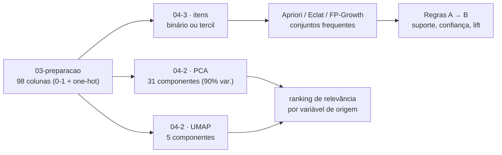

# Modelagem dos dados

Esta página descreve **o desenho do experimento de modelagem**: qual problema o modelo
resolve, sobre que unidade de análise ele opera, quais variáveis entram, qual técnica foi
escolhida e como o resultado é avaliado.

> **Nota de divisão de trabalho (16/10/2026):** a clusterização em si
> (`04-0-modelagem-cluster.ipynb` e `04-1-modelagem-cotovelo.ipynb`, que decidem o número de
> grupos e treinam os algoritmos) está sendo feita por outro integrante da equipe. Esta
> página documenta as duas peças complementares já prontas: **redução de dimensionalidade**
> (`04-2`) e **regras de associação** (`04-3`). Nenhuma das duas forma grupos: elas apoiam a
> leitura dos grupos que o `04-0` vai produzir.

## Problema

Que atributos de uma reserva de hotel realmente carregam estrutura (para a clusterização
usar como mapa de interpretação) e que combinações de características se associam a
cancelamento (pergunta 3 do PBL: *padrões de coocorrência que sustentam ou contradizem a
segmentação*). Corresponde às metas de mineração descritas no Canvas do Problema
([index.md](index.md)) sobre *agrupamento* e *associação*.

Notebooks: `notebooks/04-2-modelagem-reducao.ipynb` (PCA + UMAP) e
`notebooks/04-3-modelagem-associacao.ipynb` (Apriori/Eclat/FP-Growth).

## Unidade de análise

Um registro por **reserva** (`hotel_bookings_tratado.csv`, 119.390 linhas, saída do
`02-ajustes-dados`).

Não há chave única de reserva na base original: duas reservas idênticas em todos os campos
geram duas linhas iguais. A unidade "reserva" é mantida (não "hóspede" nem "estadia") porque
é o grão das perguntas de negócio: overbooking, canal e antecedência se decidem por reserva,
não por pessoa.

## Variáveis

As 98 colunas da matriz pré-processada (`03-preparacao`): 21 numéricas/binárias escalonadas
(0–1) e 10 variáveis nominais em One-Hot. `is_canceled` **não** é uma delas: é o rótulo
reservado para avaliação, descrito em [preparacao.md](preparacao.md).

| Pergunta do PBL pede | Variável usada | Observação |
|:---|:---|:---|
| Relevância para a estrutura das reservas | todas as 98 colunas pré-processadas | entrada de PCA e UMAP |
| Padrões de coocorrência | as mesmas 98 colunas, recortadas em itens | entrada das regras de associação |
| (nenhuma) | `is_canceled` (volta só no `04-3`) | não é atributo de entrada; só consequente de regra |

### Pré-processamento específico destes dois notebooks

- **Redução (`04-2`):** nenhum pré-processamento adicional, usa a matriz do `03` como está.
  Cada coluna One-Hot (ex. `country_PRT`) é somada de volta à sua variável de origem
  (`country`) para o ranking de relevância, com uma função que casa pelo nome da coluna.
- **Associação (`04-3`):** colunas binárias (One-Hot e *flags*) viram item quando valem 1
  (`hotel=City Hotel`). Colunas numéricas são cortadas em **tercis** (`lead_time=baixo`,
  `=medio`, `=alto`). Itens presentes em mais de 90% das reservas são descartados: não
  discriminam nada (`SUPORTE_MAXIMO = 0,90`).

## Técnica

**PCA** porque é a redução linear padrão e dá **cargas** interpretáveis (quanto cada coluna
pesa em cada componente, com sinal). **UMAP** porque captura estrutura não linear que o PCA
não vê; como não tem cargas, a relevância de cada coluna é lida por um **modelo substituto**
(random forest que aprende a prever as coordenadas do UMAP a partir das colunas: a
importância de cada coluna nesse modelo vira a relevância).

**Apriori, Eclat e FP-Growth** rodam os três sobre a mesma base de transações, e o notebook
confere que os três encontram exatamente os mesmos conjuntos frequentes. A escolha entre
eles é só de desempenho, não de resultado.

## Avaliação do modelo

| Métrica | Leitura |
|:---|:---|
| Variância acumulada do PCA | maior é melhor; o notebook para no menor nº de componentes que soma 90% |
| R² fora da amostra (OOB) do substituto do UMAP | maior é melhor; mede se a importância por coluna é confiável: aqui, **0,963** |
| Suporte, confiança, lift das regras | suporte e confiança: fração de reservas; lift > 1 é associação positiva, < 1 negativa, = 1 é independência |

Parâmetros fixados neste experimento (`04-3`): suporte mínimo 15%, confiança mínima 60%,
lift mínimo 1,2, conjuntos de até 3 itens.

!!! warning "Ressalva de métrica"
    Lift alto com suporte baixo descreve poucas reservas: é nicho, não padrão de negócio.
    Um item com suporte abaixo do corte mínimo (ex. `deposit_type=Non Refund`, com 12,2% das
    reservas) **nunca aparece em nenhuma regra**, mesmo sendo um padrão forte e documentado
    na literatura da base (99,4% de cancelamento nesse grupo). O corte de suporte filtra
    também sinais reais, não só ruído.

## Interpretação do resultado

**Redução (`04-2`):** no top 15 de relevância, 13 das 15 variáveis coincidem entre PCA e
UMAP: `hotel`, `deposit_type`, `market_segment`, `country`, `meal`, `customer_type`,
`distribution_channel`, `reserved_room_type`/`assigned_room_type` e o bloco de datas de
chegada (`arrival_date_year/month/week_number/day_of_month`). São as candidatas mais firmes
a separar perfis de reserva, e o colega pode usá-las para checar se os clusters do `04-0`
realmente se apoiam nessas variáveis.

**Associação (`04-3`):** 11.226 regras geradas, 523 fortes (confiança ≥ 60%, lift ≥ 1,2).
Entre as que terminam em `is_canceled`, destacam-se combinações de `country=PRT` com tipo de
quarto ou canal (lift ~1,8 para cancelamento) e de `lead_time=baixo` com outras variáveis de
baixa antecedência (lift ~1,3 para **não** cancelamento). Reservas de última hora cancelam
menos, o que faz sentido: sobra pouco tempo para desistir.

## Saídas

| Arquivo | Conteúdo |
|:---|:---|
| `data/processed/hotel_bookings_pca.csv` | 119.390 reservas × 31 componentes principais |
| `data/processed/hotel_bookings_umap.csv` | 119.390 reservas × 5 componentes UMAP |
| `data/processed/regras_associacao.csv` | 523 regras fortes (antecedente, consequente, suporte, confiança, lift) |
| `docs/imagens/` (gerado ao rodar os notebooks) | gráficos de variância acumulada, cargas, importância e suporte×confiança |
