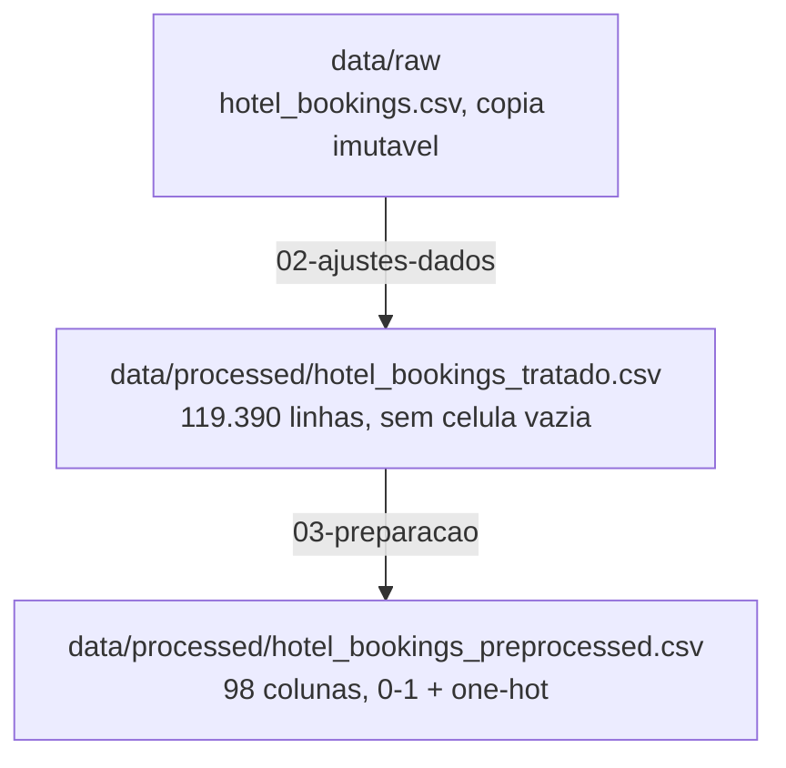

# Preparação dos dados

Esta página descreve **o que foi feito com os dados** entre a origem e a modelagem: como eles
são materializados, que regras de limpeza foram aplicadas e como a transformação é
conferida.

## Arquitetura em camadas



| Camada | Diretório | Papel |
|:---|:---|:---|
| Bruta | `data/raw` | cópia imutável da origem |
| Tratada | `data/processed/hotel_bookings_tratado.csv` | nenhuma célula vazia, colunas derivadas, duplicatas preservadas |
| Pré-processada | `data/processed/hotel_bookings_preprocessed.csv` | 98 colunas numéricas (0 a 1 e One-Hot), pronta para o modelo |

## Materialização da camada bruta

`data/raw/hotel_bookings.csv` é a cópia imutável da origem, descrita em
[Fonte dos dados](fonte-dados.md). Não há particionamento nem etapa de conversão:
a base chega num único CSV, e é lida como está pelo notebook
`02-ajustes-dados.ipynb`.

## Regras de limpeza

Implementadas em `notebooks/02-ajustes-dados.ipynb`, em uma única passada sobre a
base bruta, com cada regra registrando o motivo e a quantidade de valores afetados
em `reports/tables/ajustes-dados.csv`.

| # | Regra | Motivo |
|:-:|:---|:---|
| 1 | `children` ausente vira 0 | ausência de valor informado equivale a nenhuma criança na reserva |
| 2 | `agent`, `company` e `country` ausentes viram categoria explícita (`Sem agência`, `Sem empresa`, `País não informado`) | a ausência é informativa, não deve ser confundida com dado faltante a imputar |
| 3 | `reservation_status_date` convertida de texto para data | formato de data é necessário para qualquer leitura temporal do desfecho |
| 4 | `arrival_date` recomposta de ano, mês e dia | a origem só traz a data de chegada fragmentada em três colunas |
| 5 | `total_nights`, `total_guests`, `room_changed` e `has_special_requests` derivadas | sintetizam estadia, ocupação, troca de quarto e pedido especial em uma coluna cada, prontas para análise |
| 6 | duplicatas exatas preservadas | a base não tem chave de reserva (ver [Entendimento dos dados](entendimento-dados.md)); remover sem regra de negócio arriscaria descartar reservas legítimas |
| 7 | `reservation_status` e `reservation_status_date` mantidos, mas marcados para exclusão de qualquer modelo preditivo | descrevem o desfecho, registrado depois da reserva |

O dicionário de dados (`data/processed/dicionario.csv`, gerado em
`00-dicionario-dados.ipynb`) é a fonte dos tipos semânticos usados por essa e pela
próxima etapa; não há expressão de derivação registrada nele além das quatro
colunas derivadas, documentadas diretamente no notebook `02`.

## Conferências

Validações executadas em `02-ajustes-dados.ipynb` antes de salvar a base tratada:

- **contagem de linhas**: `assert len(df) == linhas_iniciais`, as 119.390 reservas
  continuam as mesmas depois da limpeza;
- **ausência zerada**: `assert int(df.isna().sum().sum()) == 0`, nenhuma célula
  fica vazia na base tratada;
- **auditoria por regra**: cada ajuste grava, em `reports/tables/ajustes-dados.csv`,
  a coluna afetada, a regra aplicada e a quantidade de valores que ela mudou.

Em `03-preparacao.ipynb`, a conferência é de forma: o notebook imprime o número
final de reservas e colunas da matriz pré-processada e confirma que o total de
reservas não muda (119.390), só o número de colunas (de 98 saem da transformação).

## Preparação para a modelagem

Implementada em `notebooks/03-preparacao.ipynb`. Diferente de um tema com colunas
predominantemente numéricas, a base de reservas não tem nenhuma coluna ordinal: é
dominada por categorias nominais (tipo de hotel, mês, regime de refeição, segmento
de mercado, tipo de quarto, país). Por isso a preparação classifica as colunas em
apenas dois grupos.

### Colunas fora da matriz de modelagem

| Coluna | Motivo |
|:---|:---|
| `is_canceled` | rótulo, reservado para a avaliação (fase 5), nunca usado para formar os grupos |
| `reservation_status`, `reservation_status_date` | vazamento, só existem depois do desfecho da reserva |
| `arrival_date` | repete, em texto, a mesma informação de `arrival_date_year/month/day_of_month` |
| `agent` (334 categorias), `company` (353 categorias) | identificadores de altíssima cardinalidade, dominados por uma categoria de ausência; um One-Hot sobre eles infla a dimensionalidade sem agregar perfil de reserva |

### Reduzindo a cardinalidade de `country`

`country` tem 178 categorias, a maior entre as colunas que seguem para o modelo.
Os 15 países mais frequentes são mantidos com o próprio código; os demais 163
países são agrupados em `Outro`. Detalhe completo em
[Entendimento dos dados](entendimento-dados.md#dimensoes-chave).

### Transformação

| Grupo | Colunas | Transformação |
|:---|:---|:---|
| Contínuas, discretas e binárias (21 colunas) | `lead_time`, `adr`, `total_nights`, `total_guests`, `room_changed`, `has_special_requests`, entre outras | `MinMaxScaler`, ajusta cada coluna para o intervalo de 0 a 1 |
| Nominais (10 colunas) | `hotel`, `country` (já reduzida), `market_segment`, `distribution_channel`, `meal`, `deposit_type`, `customer_type`, `reserved_room_type`, `assigned_room_type`, `arrival_date_month` | `OneHotEncoder`, uma coluna binária por categoria |

Resultado: **98 colunas pré-processadas**, salvas em
`data/processed/hotel_bookings_preprocessed.csv`, todas no intervalo de 0 a 1,
prontas para um algoritmo baseado em distância.

## Tratamento de outliers

Os valores extremos identificados na etapa 6 da EDA (regra do IQR, ver
[Análise exploratória](analise-exploratoria.md)) são mantidos, não removidos: uma
tarifa ou uma estadia fora do padrão pode ser uma reserva de grupo ou de longa
duração legítima, e removê-la distorceria o perfil real de um segmento. O
`MinMaxScaler` aplicado na preparação é sensível a esses extremos (um valor muito
alto comprime a escala dos demais), ressalva registrada, mas aceita, porque
substituí-lo por uma escala robusta a outliers não foi testado neste experimento.

## Reprodução

```bash
uv run jupyter nbconvert --to notebook --execute --inplace notebooks/02-ajustes-dados.ipynb
uv run jupyter nbconvert --to notebook --execute --inplace notebooks/03-preparacao.ipynb
```
